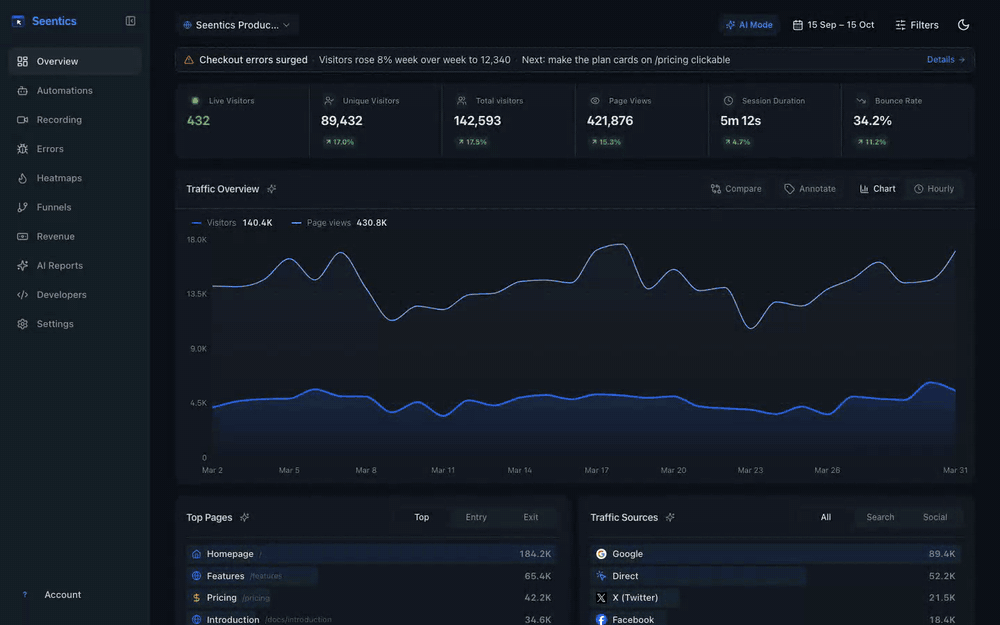

<p align="center">
  
</p>

<h1 align="center">Seentics</h1>

<p align="center">
  <strong>The open-source Google Analytics + Hotjar you can self-host in one <code>docker compose up</code>.</strong><br />
  Traffic analytics, session replay, heatmaps, funnels, revenue, on-site popups and an AI analyst.<br />
  Cookie-free by default, and it runs on just PostgreSQL and S3.
</p>

<p align="center">
  <a href="https://github.com/Seentics/seentics/stargazers"></a>
  <a href="LICENSE"></a>
  <a href="https://github.com/Seentics/seentics/commits/main"></a>
  <a href="https://github.com/Seentics/seentics/issues?q=is%3Aissue+is%3Aopen+label%3A%22good+first+issue%22"></a>
  <a href="https://seentics.com/websites/demo"></a>
</p>

<p align="center">
  <a href="https://seentics.com/websites/demo"><strong>Live demo</strong></a> ·
  <a href="#quick-start">Quick start</a> ·
  <a href="#how-it-compares">How it compares</a> ·
  <a href="ROADMAP.md">Roadmap</a> ·
  <a href="#contributing">Contributing</a> ·
  <a href="https://www.seentics.com">Seentics Cloud</a>
</p>

<p align="center">
  <a href="https://seentics.com/websites/demo">
    
  </a>
</p>

<p align="center">
  <em>Click around the <a href="https://seentics.com/websites/demo">live demo</a>. No account needed.</em><br />
  If Seentics saves you a Hotjar bill, a ⭐ helps other people find it.
</p>

---

Most teams pay for a traffic tool, a replay and heatmap tool, and a popup tool, and send
visitor data to all three. Seentics does all of that in one place, on your own servers, and
no data leaves your infrastructure.

## Features

- **Real-time analytics**: live visitor map, active pages, traffic as it happens
- **Session replays**: full recordings with rage-click and JS error detection
- **Heatmaps**: click maps, scroll depth, captured page screenshots, AI findings per page
- **Funnels**: multi-step conversion analysis with drop-off rates
- **Revenue**: orders, AOV, ARPU, UTM channel attribution
- **Behavioral automations**: popups, forms, banners, webhooks and redirects triggered by behavior, with leads sent to Mailchimp, Klaviyo, HubSpot or Zapier
- **Events and goals**: page, event or CSS-selector conversions
- **Seentics AI**: ask questions in plain English and get charts back (`⌘K`)

## How it compares

| | **Seentics** | Plausible CE | Umami | PostHog (self-hosted) | Hotjar |
|---|:---:|:---:|:---:|:---:|:---:|
| Open source | ✅ AGPL-3.0 | ✅ AGPL-3.0 | ✅ MIT | ✅ MIT | ❌ |
| Self-hosting | ✅ Supported | ✅ | ✅ | ⚠️ Hobby deploy, officially unsupported | ❌ |
| Minimum infrastructure | PostgreSQL + S3 | PostgreSQL + ClickHouse | PostgreSQL | 4 vCPU / 16 GB RAM VM | — |
| Cookie-free by default | ✅ | ✅ | ✅ | ❌ | ❌ |
| Traffic analytics | ✅ | ✅ | ✅ | ✅ | ❌ |
| Session replay | ✅ | ❌ | ✅ | ✅ | ✅ |
| Heatmaps | ✅ | ❌ | ✅ | ✅ | ✅ |
| Funnels | ✅ | Cloud only | ✅ | ✅ | ✅ |
| Revenue tracking | ✅ | Cloud only | ✅ | ✅ | ❌ |
| On-site popups and forms | ✅ | ❌ | ❌ | Surveys only | Surveys only |
| Ask questions in plain English | ✅ | ❌ | ❌ | ✅ | — |

<sub>Compiled in October 2026 from each product's public docs. These products change fast, so if a cell is wrong, <a href="https://github.com/Seentics/seentics/issues/new">open an issue</a> and we will fix it.</sub>

## Quick Start

```bash
git clone https://github.com/Seentics/seentics.git
cd seentics
docker compose up -d --build
```

Brings up PostgreSQL, objex (S3-compatible storage), the API on `:8001` and the dashboard on `:4000`.
Create a website in the dashboard, then add the tracking script below.

For production, see [DEPLOYMENT.md](DEPLOYMENT.md).

## Tracking

To test real tracking across the full OSS stack, see [Session recording E2E](web/e2e/recording/README.md)
or [Heatmap E2E](web/e2e/heatmap/README.md). From `web/`, run `npm run test:e2e:recording`
or `npm run test:e2e:heatmap`; each creates an isolated test stack and removes its disposable data afterward.

Add to your `<head>`:

```html
<script
  defer
  src="https://your-seentics-domain.com/trackers/seentics.js"
  data-website-id="YOUR_WEBSITE_ID"
></script>
```

Pageviews, scroll depth, exit intent and rage clicks are captured automatically.
`YOUR_WEBSITE_ID` is the id shown on your website's settings page.

### JavaScript API

```javascript
// Custom event, with optional properties
seentics.track('signup_click');
seentics.track('purchase', { value: 49.99, currency: 'USD', order_id: 'ORD-1234' });

// Identify a visitor. Note the argument order: id first, then traits.
seentics.identify('user_123', { email: 'user@example.com', plan: 'pro' });

seentics.page();   // manual pageview, if auto-tracking is off
seentics.flush();  // send queued events immediately
```

Revenue reporting keys off `value` and `currency` on any event; goals are configured
in the dashboard rather than in code.

## Project Layout

```
seentics/
├── core/            Bun + Hono API — a modular monolith
│   ├── app/         Composition root, where the graph is wired
│   ├── modules/     Domain modules, one table each
│   ├── platform/    Cross-cutting; owns no table
│   └── db/          Drizzle schema and migrations
├── web/             Next.js dashboard, plus public/trackers/seentics.js
└── ui/blocks/       @seentics/ui — embeddable React blocks (MIT)
```

Modules talk to each other through explicit interfaces, injected at startup; there is no
event bus. **Read [core/ARCHITECTURE.md](core/ARCHITECTURE.md) before changing `core/`** —
it covers the module boundaries, why the event bus and outbox were removed, and the known
gaps.

## Architecture

```
Browser ──┬─ tracker ──▶ POST /api/v1/tracker/collect ─┐
          └─ dashboard ─▶ Next.js :4000 ───────────────┤
                                                        ▼
                                              Bun API :8001
                                                 │        │
                                          PostgreSQL   S3 / objex
                                        (events, meta) (replays, heatmaps)
```

Tracker events are buffered in memory and flushed in batches, so `/collect` returns
without waiting on the database. Replay chunks and heatmap screenshots go to
S3-compatible storage.

| Layer | Stack |
|---|---|
| API | Bun · Hono · Drizzle ORM |
| Dashboard | Next.js 15 · Tailwind · shadcn/ui |
| Data | PostgreSQL 16 · S3-compatible object storage |
| Replays | rrweb |

## Contributing

```bash
cd core
bun install
bun run check   # typecheck — expected to be clean
bun test        # ~630 tests, no database or S3 required
bun run dev
```

CI runs `check` and `test` on every pull request, and both are expected to pass.
Tests use in-memory doubles of the module interfaces, so no services are needed.

Two things worth knowing before you write tests: `mock.module` is process-global in
Bun, so an incomplete stub becomes the real module for every later test file — make
stubs complete. And `core/ARCHITECTURE.md` lists the current known gaps if you are
looking for something to pick up.

See [CONTRIBUTING.md](CONTRIBUTING.md) for the PR process.

New here? Issues labelled [`good first issue`](https://github.com/Seentics/seentics/issues?q=is%3Aissue+is%3Aopen+label%3A%22good+first+issue%22)
are scoped to a single file or two. Adding an integration provider, for example, means adding one file under
`core/modules/integrations/providers/` and one line in its `registry.ts`. The [roadmap](ROADMAP.md) lists what is
planned, and [Discussions](https://github.com/Seentics/seentics/discussions) is the place for questions and ideas.

## License

[GNU AGPL v3.0](LICENSE) — self-host freely; modifications must be released under
the same license. The [`@seentics/ui`](ui/blocks) package is separately
[MIT](ui/blocks/LICENSE).

---

<p align="center">
  Don't want to run it yourself? <a href="https://www.seentics.com">Seentics Cloud</a> is the same product, hosted.<br />
  Built by the <a href="https://github.com/Seentics">Seentics</a> team ·
  <a href="https://github.com/Seentics/seentics/issues">Report an issue</a>
</p>
